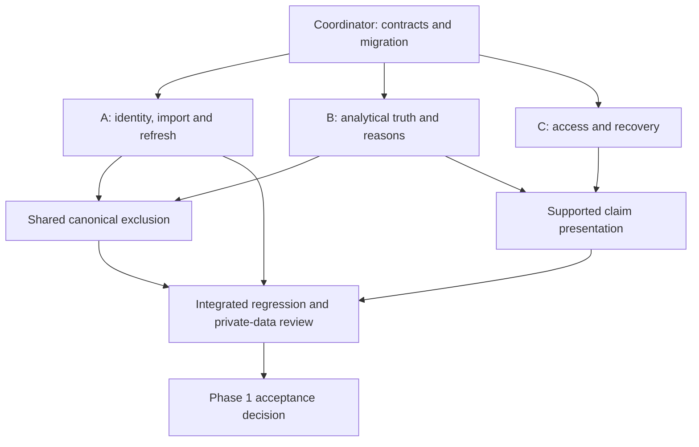

# CINEMA DNA — Implementation roadmap

> **Historical audit.** Synthetic evidence only. Application audited at `b7a732a`; file and line references are valid at that commit. Findings are not measurements of the owner's personal recommendation accuracy. This document ships no fixes. Current status and the adopted repair sequence: [AUDIT_STATUS.md](AUDIT_STATUS.md). Screenshots and PDFs are archived at tag [`audit-2026-10-26`](https://github.com/shaecodes-wilde/cinema-dna/tree/audit-2026-10-26/docs). The coordinator, schema-freeze and three-worktree Phase 1 orchestration below was superseded by the smaller sequential sequence in AUDIT_STATUS.md; its architecture ideas remain a future backlog.

**Planning basis:** audit of `b7a732a5b076858f5cee92da0c9408dded0823a0` on 26 October 2026.

**Status:** recommendation only. No application implementation began during the audit.

**Purpose:** make the existing product dependable, measure its intelligence, then add a small number of distinguishing capabilities.

## Decision and sequencing

Authorize **Phase 1: trustworthy data, claims and access** first. The largest current risk is a user believing a compelling conclusion that is unsupported or contradicted by their records. The first phase fixes the reproduced failures, keeps the useful architecture, and establishes contracts for future work. It does not require a new backend, hosted model, embedding service or visual redesign.

The subsequent order is: independent model evaluation; broader discovery and persistent feedback; targeted design polish; then selective experiments with review intelligence and cinematic programs. An unsuccessful model comparison is a valid result: the product should fall back to transparent descriptive/content recommendations instead of declaring a win.

Finding IDs refer to the [technical](TECHNICAL_AUDIT.md), [intelligence](TASTE_INTELLIGENCE_AUDIT.md) and [design](DESIGN_UX_AUDIT.md) reports. Paths and lines refer to the audited commit; line numbers will move once implementation begins. Synthetic evidence proves a defect is possible, not its frequency in the owner's actual export.

### Priority and effort definitions

| Label | Meaning in this roadmap |
|---|---|
| **P0 — Critical** | Reproduced blocker in an advertised workflow, fundamentally invalid analysis presented as evidence, or a concrete violation of a core product guarantee. No actual privacy breach was found. |
| **P1 — High impact** | Major accuracy, recommendation, usability or reliability gain that should follow or accompany the critical repairs. |
| **P2 — Product polish** | Improvements to an already usable experience or bounded hardening of the current trusted local workflow. |
| **P3 — Experimental** | Differentiation hypotheses that need evidence of usefulness before broad development. |
| **Small** | A localized change with a clear regression fixture and little schema impact. |
| **Medium** | Several modules or one shared contract, requiring integration and migration decisions. |
| **Large** | Multiple contracts, evaluation infrastructure or new persistent user behavior. These are relative estimates, not delivery promises. |

## Canonical improvement backlog

These packages consolidate related findings so several agents do not independently patch the same symptom. Each package names the specific evidence, remedy, benefit, dependencies and objective finish condition.

### R1 — P0: make unavailable evidence and comparison cohorts explicit

**Problem and evidence.** A valid 20-film dataset with runtimes only for five high-rated long films crashes at `pipeline/analyze/insights.ts:120–128`. Sixty matched films with empty fields produce high-confidence zero genre/darkness/franchise/award scores. Five identical Comedy+Horror records can generate positive “synergy” solely because group and pair shrinkage differ. Six top-rated films with no lower-rated comparison films generate a top-versus-rest conclusion. See INT-03–05 and INT-07; [14-scenario results](audit-evidence/results/intelligence/probe-results.json).

**Solution.** Introduce field availability and explicit cohort support into analysis contracts. Distinguish known presence, defensible known absence and unknown. Require every comparison to declare its populations and valid denominators. Short term: call the pair view “joint-tag affinity,” remove causal/interaction language without exclusive cohorts, guard absent runtime groups, and render unavailable DNA dimensions as unavailable. Keep observed counts available even when inference is not.

**User benefit.** Partial metadata no longer breaks the product or masquerades as an established preference. Strong-looking charts describe what is actually measured.

**Effort:** medium–large; the crash guard is small, but consistent missingness is shared work. **Dependencies:** coordinator-owned feature/claim schema; B stream implementation; A supplies metadata state. **Trade-off:** fewer dramatic claims may appear until coverage improves. That is the correct result.

**Acceptance.** All-long-only, all-short-only, all-unknown, empty and constant groups complete; zero genre coverage cannot yield high-confidence genre scores; identical parent/intersection observations yield no interaction claim; empty comparison cohorts yield unavailable evidence; all numerical output is finite or explicitly null. Tests assert invariants, not current prose snapshots.

### R2 — P0: make narrative and recommendation reasons follow the computed evidence

**Problem and evidence.** Rewatch ratings falling 5→1★ are interpreted as increased appreciation; 3★ is described as below average despite a 1.5★ mean; unavailable/tied models claim real signal; a Drama-only candidate gets “Horror: +0.47★” because an absent centered feature contributes positively. See `pipeline/analyze/insights.ts:80–115`, `pipeline/analyze/narrative.ts:73–95,124–125,188–198`, `pipeline/analyze/report.ts:129–151`, `pipeline/analyze/model.ts:242–251`, `pipeline/analyze/recommend.ts:193–206` (INT-01–02, ENG-06).

**Solution.** Use one typed claim registry across JSON, UI, Markdown and HTML. A claim contains its estimand, evidence records, denominator, effect direction, calculation/version and support status. Separate observation, estimate and hypothesis. Recommendation reasons additionally include candidate feature state and the exact reference/contribution. Remove fixed psychological and causal interpretations. Label current CV metrics as development diagnostics until R7 qualifies them. A no-metadata fallback must really use its documented baseline or explain its remaining known predictors.

**User benefit.** The app can retain its editorial voice while becoming accountable. Users can inspect why a statement or recommendation exists and see what would change it.

**Effort:** medium–large. **Dependencies:** R1 contracts and one owner of direct frontend copy; no LLM dependency. **Trade-off:** explanatory precision may require a short summary plus expandable detail rather than a single confident sentence.

**Acceptance.** Positive, negative, zero and absent effects yield appropriate language on every surface; no NaN/Infinity; no superiority claim from unavailable or non-improving evaluation; reasons name a present verified feature or explicitly describe a known absence; attributed terms reconstruct the documented pre-clamp score; psychological hypotheses are visibly distinguished from measured facts. A reviewer can follow each selected statement to actual film/event IDs.

### R3 — P0: preserve known metadata through offline refresh and publish coherent snapshots

**Problem and evidence.** Adding Beta to an enriched one-film Alpha dataset changes a batch lookup cache key; an offline run publishes zero matches despite the Alpha entity cache remaining usable. Standalone enrichment returning mocked HTTP 401 exits 0 and creates no metadata file. Direct overwrites have no transactional generation manifest. See ENG-03–04, `pipeline/enrich/index.ts:37–137`, `pipeline/enrich/wikidata.ts:119–157`, `pipeline/cli.ts:50–71`, `pipeline/paths.ts:27–34`.

**Solution.** Store reusable per-film match decisions with stable identity fingerprints. Merge offline/cache-miss outcomes conservatively with previous successful fields; preserve intentional null overrides. Introduce complete/degraded/failed stage results, snapshot IDs and validated temporary output files followed by one atomic manifest switch. A standalone failed stage exits nonzero. Do not publish an older dataset/newer metadata mixture as a fresh success.

**User benefit.** Routine incremental imports remain usable without network access; agents and users can distinguish completed work from failed or partial work.

**Effort:** medium–large. **Dependencies:** A stream plus the identity/match/persistence contract frozen in Phase 0; implement R3 and R5 incrementally within A, without waiting for either entire package to finish first. **Trade-off:** cache migration and explicit stale/unknown markers add some complexity but avoid repeated lookups and lost derived coverage. The observed bug changes derived metadata, not raw ZIP contents.

**Acceptance.** Adding one uncached film offline preserves all valid previous matches and marks only new information unavailable. Input order does not alter matching. Injected failure after each stage leaves a valid previous snapshot readable. Successful outputs share one source/snapshot ID. Standalone failures have nonzero exit codes and actionable stage summaries. Original export bytes remain unchanged.

### R4 — P0: apply one watched-film exclusion policy to every recommendation source

**Problem and evidence.** A watchlist record and watched record with the same validated QID can both survive because `pipeline/analyze/index.ts:283–288` checks only the watchlist record's flag, while discovery has additional identity checks at `311–318`. The audit reproduced the watched work being recommended (INT-06).

**Solution.** Merge source candidates through one canonical identity and exclusion interface before ranking. Preserve source membership and reasons separately from film identity. Treat uncertain collisions as a review question rather than equating every similar title. A future rewatch feature uses an explicitly separate lane; it must not weaken discovery exclusion.

**User benefit.** “Find me something new” consistently means an unwatched work, even when records or metadata sources differ.

**Effort:** medium. **Dependencies:** A owns identity resolution; B owns candidate merge/exclusion after the contract is frozen. **Trade-off:** conservative unresolved identities may need a user correction instead of automated inclusion/exclusion.

**Acceptance.** No candidate sharing a validated canonical watched identity survives from watchlist, creator, award or future embedding channels. Same-name remakes and genuine distinct works remain distinct. Duplicate candidates merge deterministically with source provenance retained.

### R5 — P1: validate imports, resolve ambiguity conservatively and make matching confidence auditable

**Problem and evidence.** Rating 99 creates a 23★ mean; date-shape validation accepts impossible/future dates; an extra CSV column crashes `.trim()`. Two same-title/year film URIs attach a diary row to whichever appears first; a late list ID can duplicate a fallback film. Guessed slugs receive stronger authority than justified, absent years look like perfect agreement, duplicate entity candidates create false ambiguity, and TMDB can choose a near-year hit over an exact-year hit. See ENG-01–02 and ENG-05.

**Solution.** Validate parser errors, required headers, rating range/increments and actual calendar dates. Quarantine invalid fields/rows with source references and policy. Build the complete identity candidate index before resolving diary/review entries, including lists. Keep ambiguity unresolved with candidates and overrides. Deduplicate metadata candidates by entity ID, distinguish verified identifiers from guessed slugs, rank exact year appropriately and measure matching precision on a labeled fixture corpus. Expose canonical IDs and a useful correction path in the UI.

**User benefit.** Corrections are possible, wrong joins do not silently become facts, and quality labels mean something specific.

**Effort:** large across ingest/matching; split internally after the schema decision. **Dependencies:** shared normalized/audit/identity contracts from Phase 0; co-develop stable match storage with R3 inside A. **Trade-off:** abstention may lower apparent match coverage while raising precision; preserve that distinction. Actual prevalence in the owner's export is unknown.

**Acceptance.** Normalization is invariant to input row ordering. Invalid rating totals and histograms cannot disagree. Ambiguous entries are not marked confidently linked. The late-ID fixture yields one film with preserved sources. Error messages name file and row. A known-year exact match wins over a weaker near-year match; missing-year uncertainty is explicit. Overrides remain authoritative across refreshes.

### R6 — P1: make the existing interface accessible and resilient

**Problem and evidence.** A valid JSON `{}` bundle causes an empty page outside useful error boundaries; Shift+Tab escapes a modal drawer; Source radio controls ignore ArrowRight; mobile navigation exposes number-only names; faint text measures 2.43–2.73:1; broken poster URLs leave blank tiles; report sections remain invisible when printing before scrolling. All are documented in the design report with runtime/contrast evidence. Relevant contracts include `src/lib/data.tsx:107–117`, `src/App.tsx:31`, `src/ui/FilmDrawer.tsx:15–25,67–76` and shared primitives/styles.

**Solution.** Runtime-validate AppData with versioned diagnostics and a top-level recovery boundary. Use a correct modal/focus primitive and radio keyboard pattern. Keep meaningful navigation names at every width. Raise informational contrast, provide image error fallbacks, and make print independent of scroll-triggered reveals. Replace the clipped static reduced-motion shelf with a manually scrollable/list alternative; animation already stops correctly. Keep the current palette, typography and chapter structure.

**User benefit.** The product remains usable when data is bad, images fail, motion is reduced or the user navigates by keyboard/phone. Reports can be reliably saved and shared privately.

**Effort:** medium. **Dependencies:** C owns shared UI primitives; coordinator supplies AppData schema/status; no algorithm rewrite required. **Trade-off:** denser mobile charts may need equivalent tables or bars, not scaled-down desktop graphics.

**Acceptance.** Malformed/mismatched/missing bundles show actionable recovery without blank-page crashes. Tab/Shift+Tab remain inside the open drawer; Escape closes and restores focus. Radio keys and accessible names work. Informational normal-size text meets 4.5:1. A deliberately broken poster preserves a readable title. An unscrolled print includes every section. All items remain reachable with reduced motion. Test 320/390/768/1440 widths, with physical-device and assistive-technology verification before claiming broad accessibility.

### R7 — P1: qualify prediction and ranking against independent baselines

**Problem and evidence.** `pipeline/analyze/model.ts` rebuilds people encoders and baselines in training folds correctly, but global feature-frequency selection precedes splitting and lambda selection/reporting use the same CV results. Rating reconstruction is not evidence of successful discovery. No personal historical evaluation could be run during the audit. See INT-11 and the intelligence report's evaluation protocol.

**Solution.** Add an offline evaluation command with canonical film-group outer splits and inner-only transforms/tuning, or freeze choices before an untouched evaluation set. Compare training mean/median, shrunken content affinity, content neighbors and existing ridge on the same eligible candidate universe. Distinguish candidate retrieval recall from ranking. A single current export is not an immutable historical record: qualify temporal splits when edited ratings/as-of metadata cannot be recovered. Keep genuine future evaluation separate from retrospective reconstruction.

**User benefit.** The product can say when its predictions add value, which films/regions it cannot assess and when a simpler method is safer.

**Effort:** medium–large. **Dependencies:** R1/R4/R5; personal data must be available locally for personal conclusions. **Trade-off:** nested evaluation costs more offline compute and can reveal no useful predictive gain. That should change the product claim, not the test.

**Acceptance.** Report MAE/RMSE/Spearman/calibration on held-out rated films and NDCG@10/20, Precision/Recall with predeclared relevance thresholds on clearly defined labeled test pools. Show paired uncertainty and effective sample sizes. Unwatched films are unknown, not presumed negatives. All transforms, seed creators and review-derived features exclude held-out targets. No ranking superiority claim without an independent comparison. Preserve the existing correct fold-local person encoders. Do not set a fictional percentage-gain target before measuring baselines.

### R8 — P1: improve discovery reach and close the user feedback loop

**Problem and evidence.** Discovery eligibility favors notable creators/cast and award films; a novelty slider cannot recover absent candidates. There is no persistent dismissal, shortlist, seen correction or outcome store. See INT-12, `pipeline/analyze/recommend.ts`, `src/chapters/Next.tsx` and `src/chapters/next/RecCard.tsx`.

**Solution.** Add a broad public-metadata content-neighbor channel, an explicit exploration channel and source-level diagnostics. Merge/deduplicate/exclude before ranking. Diversify a bounded top set using feature similarity and optional creator/franchise caps. Add local, exportable feedback events for interest, already seen, durable disinterest and temporary session mismatch, with candidate/model versions. Start with a practical shortlist and “not tonight” distinction; do not immediately build a conversational agent.

**User benefit.** Recommendations reach unfamiliar relevant films, become less repetitive and help the user actually choose. Feedback also supplies future validation evidence.

**Effort:** large, split retrieval and UI after a small event-schema agreement. **Dependencies:** R4/R7; privacy boundaries for new metadata services. **Trade-off:** diversity may reduce predicted score, so expose intent; explicit feedback has interaction cost, so keep it optional and lightweight.

**Acceptance.** Evaluate retrieval coverage for withheld positive films independently of reranking. Compare diversity/director concentration and relevance under a fixed candidate pool; preserve a conservative option. Already-seen feedback excludes the film everywhere; temporary mismatch does not permanently infer dislike. Local events survive reload/export/import, and no private review/profile is sent to a service by default. Prospective recommendation outcomes remain clearly separated from offline metrics.

### R9 — P2: refine visual semantics and the portrait-to-decision journey

**Problem and evidence.** DNA mixes heterogeneous percentage/index dimensions with clamped affinity; genre exposure uses an undisclosed square-root scale; genre labels overlap; director dot strips cap ties; constellation neighbors use projected distance; formula visuals parse prose; recommendation evidence is dense and caveats are less visible on mobile. See the design chapter inventory and INT-09–10/13.

**Solution.** Use clear units and comparable baselines; provide a ranked-bar mobile alternative to the radar. Distinguish watched count, rated count and enjoyment in director/genre views. Represent tied counts exactly or label aggregation. Compute neighbors in original feature space and explain shared attributes. Supply typed chart data instead of parsing prose. Keep an inspectable evidence panel and guide the user from portrait to one selected film.

**User benefit.** Beauty remains, but the visual shapes no longer imply unsupported precision or hide meaningful records.

**Effort:** medium; several small independent chapter tasks after shared primitives stabilize. **Dependencies:** R1/R2 semantics, R6 accessibility; original-space neighbor correction can be pulled forward into Phase 1 if localized. **Trade-off:** some cinematic displays should remain exploratory rather than carrying quantitative comparison duties.

**Acceptance.** Every axis/mark states unit, population and aggregation; clipping/capping is visible; selected records agree across charts and Explorer; mobile alternatives expose the same data. Neighbor ranking is independent of UMAP screen coordinates. Compare task completion for finding a preference, inspecting its evidence and choosing a film; do not optimize solely for visual preference votes.

### R10 — P2 now / P1 before external uploads or hosting: harden the deployment and file boundary

**Problem and evidence.** A 16,634-byte ZIP containing a 16 MiB ignored member caused roughly 16.8 MB extra ArrayBuffer allocation before filtering; directory import follows symlinks. The generated bundle contains personal records and is copied byte-for-byte into `dist`. This is a packaging property, not evidence of a public leak. README already warns against public deployment. No tracked secret was found. See ENG-07 and the technical privacy section.

**Solution.** Add entry/expanded-size/count/ratio limits and reject symlink escape/cycles before accepting untrusted imports. Keep safe local defaults. Add a deliberate private/shareable build distinction or deployment preflight if publishing becomes a product goal; sanitize by allowlist rather than hiding UI labels. Clarify metadata-query and poster-request disclosure. Review dependency/font/data notices and TMDB attribution when that integration is enabled. Align documented Node requirements with the supported tested runtime.

**User benefit.** Local use stays simple, while accidental public exposure and resource exhaustion become less likely if scope expands.

**Effort:** small–medium for local hardening; larger for a hosted threat model. **Dependencies:** publishing/upload scope must be explicit; no hosting is required by this roadmap. **Trade-off:** limits need documented overrides for large legitimate exports. Do not mislabel in-memory ZIP parsing as a demonstrated filesystem ZipSlip vulnerability.

**Acceptance.** Bounded synthetic oversized/cyclic fixtures fail before unsafe resource use; valid exports remain readable; no source file is modified. A deliberately shareable output is checked for reviews/profile/tags/lists and contains only approved fields. No default frontend bundle contains credentials. Attribution requirements are verified against current provider documentation when shipping.

### R11 — P2: optimize measured user delays, not hypothetical bottlenecks

**Problem and evidence.** JS is 623.03 kB raw/191.43 kB gzip, and the app fetches one complete bundle. Four-thousand-record constellation generation took 10.52 s with about 311 MiB RSS in a single synthetic run. Shared context, tooltip motion and SVG zoom may cause excessive updates, but those user-facing bottlenecks were not profiled. See engineering performance analysis.

**Solution.** Establish representative production traces on an actual phone and a realistic private export. Measure initial parse/render, filter-to-paint, drawer open, map interaction, long tasks and import stage timings. Then split infrequently used chapter code, narrow state subscriptions, cache stable offline computations or move measured UI map-interaction work off the main thread where justified. Constellation generation already runs offline; do not treat that existing separation as a missing optimization. Avoid a blanket canvas rewrite or vector database migration.

**User benefit.** Engineering effort removes delays the user actually feels while protecting accessible interaction and maintainability.

**Effort:** small measurement phase; implementation depends on results. **Dependencies:** stable correctness baseline and production build. **Trade-off:** lazy loading can add navigation latency; canvas can reduce accessible semantics; workers add serialization cost.

**Acceptance.** Repeated before/after traces on the same fixtures and device show improvement in a declared user task with no accuracy/accessibility regression. Record distributions, not one best run. Set budgets from the observed baseline; stop broadening tests when the identified risk is resolved.

### R12 — P3: test richer taste understanding with private aspect evidence

**Problem and evidence.** Current features do not measure pacing, atmosphere, visuals, narrative structure or experimental form. Lexicon examples “not good” and “not bad” reverse sentiment; word occurrence does not distinguish praise from criticism. See INT-14 and the DNA dimension table.

**Solution.** Build a small labeled set of private review passages locally. Separate aspect, polarity, negation, uncertainty and supporting quote span. Compare transparent rules with a local model before a full feature. Public-film synopsis embeddings can improve retrieval separately; private reviews need not be sent to generate public content vectors. If hosted inference is considered, require explicit consent for the exact data and budget. A prose generator consumes verified claims, not raw guesses presented as statistics.

**User benefit.** Nuanced taste statements can become specific and falsifiable, and recommendations can connect several loved films through supported aesthetic qualities.

**Effort:** large exploratory work. **Dependencies:** R1/R2/R7, adequate reviews, local compute and labeled evaluation. **Trade-off:** sparse/sarcastic reviews, model error and review-writing selection bias may limit benefit. More fluent language is not proof of better recommendations.

**Acceptance.** Aspect/polarity extraction is evaluated against held-out user-validated spans, including negation and mixed sentiment. Removing/adding a passage changes claims predictably. No claim lacks an accessible evidence span; no private text leaves the approved boundary. Keep the feature only if it improves useful explanations or qualified ranking enough to justify cost.

## Candidate product opportunities: select, do not accumulate

The requested concepts are valuable at different stages. The following decisions weigh benefit, feasibility and evidence dependencies rather than treating every idea as mandatory.

| Requested idea | Expected usefulness / distinction | Feasibility and ongoing cost | Decision and success test |
|---|---|---|---|
| Taste Archaeology | Potentially strong personal story about phases and turning points | Medium–large; genuine viewing dates, comparable samples and change-point stability; local compute | Later pilot after timeline repairs. Changes should survive sensitivity checks and match the user's recollection; do not infer life events |
| Taste Outliers | Useful counterexamples that challenge an overly simple profile | Medium; qualified out-of-sample residuals, not training errors | Phase 2 adjunct. Show prediction error, coverage and evidence; user judges whether the surprise is meaningful |
| Cinematic Neighbourhoods | Builds on an existing distinctive map | Medium; original-space similarity, stable cluster explanations; low local cost | Improve existing map before adding a second one. Verify neighbor semantics and discoverability |
| Perfect Movie Formula | Attractive label but especially prone to overclaim | Medium–large for supported interactions; many comparisons | Rename “preference combinations.” Only show supported contrasts with uncertainty; no causal formula promise |
| Director Compatibility | Directly useful for choosing unfamiliar filmographies | Medium; public creator metadata and uncertainty from sparse evidence | Phase 2/3 after evaluation. Assess unseen-director slice separately from familiar-creator continuation |
| Taste Discovery Mode | High value for finding relevant unfamiliar cinema | Medium–large; wider candidate sources and diversity | Prioritize within R8. Measure candidate coverage, qualified relevance and user-rated novelty |
| Taste Fingerprint Over Time | More interpretable than a single timeless personality score | Medium; fixed definitions, comparable periods and missingness | Later after dates/coverage. Prevent changing denominators from appearing as preference change |
| Review Intelligence | Best route to genuine nuance if enough writing exists | Large; local inference plus validation; optional GPU/model cost | Small R12 experiment before a large LLM feature |
| Movie Match Explanations | Immediate trust and decision value | Medium; typed attributes, several evidence anchors | Prioritize R2, then expand to public semantic links after evaluation |
| Interactive Taste Interview | Can resolve ambiguous evidence without requiring another film | Medium–large; information-gain question selection and explicit answers | P3 limited paired-choice trial. Test ranking improvement per answered question; do not infer personality from generic prompts |

### Original additions beyond the requested ideas

The first two below are the strongest practical candidates after the reliability phase. The rest are bounded experiments, not automatic commitments.

| New feature | Specific problem and proposal | Benefit, effort and dependencies | Verification / decision |
|---|---|---|---|
| **Tonight's viewing contract** | Separate “90 minutes, subtitles welcome, low attention tonight” from enduring dislike | High decision usefulness; medium local UI/event schema; R8; no paid API required | Shorter time to a satisfying choice, without permanent penalties from temporary constraints. Prioritize a small version |
| **Recommendation debt shelf** | Repeatedly ignored films dominate suggestions; offer a reason and rotate them responsibly | Small–medium, low local cost; persistent feedback | Fewer repeated unwanted picks, recoverable decisions and no conflation of ignored with disliked. Prioritize with feedback |
| **Evidence sensitivity switch** | A franchise or prolific director can dominate a claim; let the user exclude it and compare | Medium cached local recalculation; claim lineage | Show which claims survive; deterministic results and understandable denominator changes. Strong trust-oriented follow-up |
| **Correction ripple preview** | A metadata correction has invisible consequences; preview affected charts/recommendations before applying | Medium; versioned lineage and deterministic recompute | Exact before/after claim changes; no unrelated drift. Useful once correction UI exists |
| **Double-feature composer** | Two independent top picks do not necessarily make a good evening; pair a familiar anchor and discovery under a runtime budget | Medium bounded pair search over a short candidate list; R8, accurate runtime | Verifiable creative bridge, feasible total length, user choice versus independent picks. Prototype later |
| **Expectation notebook** | A star rating cannot distinguish overhype from disliked execution; optionally record one expectation and one outcome | Small–medium local schema/UI; no semantic model initially | Low entry burden and useful hindsight; later test whether explicit aspect feedback improves calibration |
| **Rewatch wager** | An old favorite may be the best choice when taste changes; create an explicitly separate lane with a testable hypothesis | Medium; trustworthy dates, prior and subsequent ratings | Discovery still excludes watched films; anticipated versus actual rewatch response is logged honestly. Experimental |
| **A finite personal season** | Infinite lists create indecision; build a six-film program with a theme and controlled departures | Medium–large constrained selection; R8 and evidence explanations | Program completion, satisfaction, variety and ease of substitution. Pilot only after individual recommendations work |
| **Blind discovery cards** | Prestige/posters can dominate interest; offer an optional spoiler-safe anonymous premise before reveal | Small UI, accurate public synopsis; no hidden warnings | Compare interest before/after reveal, with user control. Low-cost experiment after trustworthy cards |

## Coordinated implementation phases

### Phase 0 — coordinator contract and baseline

This is the opening part of the next authorized engineering session, not work completed in this audit.

1. Inspect the then-current branch/commit and uncommitted changes; retain this audit's source commit as the baseline reference. Create an implementation integration branch from the chosen base. Do not overwrite an existing user's worktree.
2. Reproduce the small critical fixtures in an isolated checkout. Read all three specialist reports before touching shared contracts. Retain the 47-test baseline and only add regressions tied to demonstrated or newly introduced risk.
3. Define normalized schema version, stable film identity interface, per-field availability/provenance, snapshot/stage status, claim support and recommendation explanation types. Choose migration behavior for existing private JSON files. Keep original ZIPs immutable.
4. Assign single owners for shared files below. Merge this small contract change first so each worker builds against the same interfaces.

**Exit:** contracts reviewed with example complete/degraded/ambiguous records; old artifacts either migrate explicitly or produce an actionable regeneration message. No schema is silently interpreted as another version.

### Phase 1 — three isolated worktrees in parallel

With a coordinator and three workers, the following arrangement fits four concurrent agent slots. Additional subprojects are sequential inside a stream, not extra workers competing for shared files.

| Stream / proposed branch | Exclusive scope | Order inside stream | Deliverable |
|---|---|---|---|
| **A — `fix/import-identity-refresh`** | `pipeline/ingest/**`, `pipeline/enrich/**`, `pipeline/cli.ts`, `pipeline/paths.ts`, focused ingest/enrich tests | Validation/identity candidates → reusable matches → status/atomic publication | R3/R5 and canonical exclusion interface for R4; source preservation and failure injection evidence |
| **B — `fix/analytical-evidence`** | `pipeline/analyze/**`, focused analytical tests; coordinator integrates shared-file changes | Sparse-group crash/missingness → comparison truth → narrative/explanations → unified exclusion; timeline rated denominator | R1/R2/R4, honest current-model labels, targeted INT-09/10/13 corrections |
| **C — `fix/access-and-recovery`** | `src/**`, focused browser/component tests | Bundle/schema recovery → modal/radio/nav/contrast → image/reduced-motion/print → evidence status presentation | R6; current visual identity preserved |

Stream B should not independently rewrite ingestion IDs. Stream C should not repair analytics by recomputing metrics in components. Stream A should not publish a new bundle shape without coordinator agreement. Changes to report prose in B must be reflected in any direct UI copy in C through the shared claim interface.

**Integration order:** shared contracts first; then A's identity interface and B's pure statistical repairs; then shared exclusion/claim production and C's consumers; finally full import-to-UI checks. Merge small reviewed changes rather than three late, incompatible rewrites. The coordinator resolves shared-file changes explicitly; never use “ours/theirs” to suppress a schema conflict.

**Phase 1 acceptance:** the critical fixture matrix below passes; existing tests/types/lint/build pass; only coherent validated snapshots load; UI can inspect evidence with keyboard/mobile/print; raw export hashes do not change; no private records appear in git or unapproved network payloads. Record remaining personal-data verification gaps without inventing a quality score.

### Phase 2 — evaluation and trustworthy discovery

After the contracts are stable, parallelize (A) isolated evaluation/baselines, (B) wider public-content retrieval, and (C) persistent local decision feedback. Freeze the candidate/event contracts before branching. Keep model comparison independent of feature tuning. Do not let a UI experiment silently change relevance thresholds or holdout sets.

**Exit:** a reproducible evaluation report with uncertainty and failure slices; a documented fallback when personalization is not qualified; canonical exclusion across all sources; source-level retrieval coverage; durable local feedback; truthful evidence-based recommendation cards. Personal results require the real export locally; absent that, deliver tooling and clearly labeled synthetic checks only.

### Phase 3 — targeted product polish and measured performance

Implement R9's chapter-specific improvements and R11's measured bottlenecks. Keep layout, color, mark meaning and evidence patterns coherent through shared primitives. Prototype Tonight's viewing contract and recommendation debt handling before a much larger feature surface. Apply R10's hosted/upload prerequisites only if that scope is actually chosen.

**Exit:** representative users can find one preference, inspect contrary evidence and select a film without instruction; keyboard/mobile alternatives reach the same information; measured performance regressions stay within declared budgets; results are recorded rather than summarized as “feels faster.”

### Phase 4 — one bounded differentiation experiment at a time

Choose one of local Review Intelligence, a finite film season, a focused Taste Interview or a sensitivity/archaeology view. Predeclare the user benefit and abandonment criterion. Do not simultaneously launch every original idea. Keep feature flags or reversible output versions so experiments cannot contaminate established taste claims.

**Exit:** evidence of useful improvement at tolerable user burden and ongoing cost. If the experiment fails, retain the learning without turning the prototype into a permanent maintenance obligation.

## Shared-file and schema conflict register

| File/contract | Single owner | Required coordination |
|---|---|---|
| `shared/types.ts` | Coordinator | A proposes normalization/matching/status changes; B confirms analytics semantics; migrate existing private artifacts |
| `shared/app-types.ts` | Coordinator | B proposes claims/feature states; C confirms render/recovery needs; one versioned contract |
| `pipeline/analyze/index.ts` | B, with coordinator review | A supplies identity/status helpers; B alone integrates records/candidates/output assembly |
| `pipeline/analyze/features.ts` | B | Shared interpretation of unknown/known states; no competing UI-derived substitutes |
| `pipeline/paths.ts` and `pipeline/cli.ts` | A | Snapshot publication affects all outputs; coordinator approves stage/exit semantics |
| `pipeline/analyze/insights.ts`, `narrative.ts`, `report.ts` | B | One claim renderer contract; C removes contradictory direct presentation copy |
| `pipeline/test/fixtures.ts` | Coordinator or designated fixture owner | Workers add separate scenario files where possible; do not rewrite common fixtures to make failures disappear |
| `src/lib/data.tsx`, `src/ui/primitives.tsx`, `src/styles.css` | C | Schema changes arrive through coordinator; chapter work waits for stabilized primitives |
| `package.json`, `package-lock.json`, TypeScript/Vite config | Coordinator | No parallel dependency upgrades; add a library only for a specific justified contract |
| Personal raw/cache/normalized/public-data/report files | No worker commits them | Tests use per-worktree scratch directories; no shared mutable fixture output paths |

Use separate worktree build/output directories. Do not run CLI probes against the owner's main data directory: `pipeline/paths.ts` resolves its root from the module location, so merely changing shell cwd is not isolation. The portable audit reproductions explain safe temporary execution.

## Targeted acceptance matrix

| Fixture or task | Required invariant | Owner |
|---|---|---|
| Quoted multiline/BOM/non-Latin valid CSV | Correct records preserved with source references | A |
| Invalid rating, extra column, impossible/future date | Actionable validation; no impossible aggregates or trusted bad date | A |
| Same title/year with two URIs, permuted rows | No order-dependent confident join | A |
| Diary fallback then later list URI | One reconciled film when identity is uniquely supported | A |
| Cached Alpha + uncached Beta, offline | Alpha match survives; Beta is unavailable; no network | A |
| Injected stage error / stale schema | No false success or mixed snapshot; last valid output remains usable | A/C |
| All metadata fields unknown | No high-confidence preference score from missingness | B |
| Only known long runtimes / no comparison group | Analysis completes; comparison unavailable | B |
| Identical paired genres / no exclusive groups | No synergy claim | B |
| All top-rated / no lower-rated films | No invented zero-proportion comparator | B |
| Falling/rising/flat rewatches and cold-rating user | Correct directional language everywhere | B/C |
| No model, constant ratings, model ties/worse than baseline | No NaN or predictive-superiority assertion | B |
| Absent negative feature / missing candidate metadata | Reasons state feature presence/reference accurately | B |
| Watched identity through every candidate channel | No ordinary discovery recommendation leak | A/B |
| Rated plus unrated diary entries | Rolling average weights rated entries, not all viewings | B/C |
| Missing/invalid bundle and broken image | Useful recovery and readable fallback | C |
| Modal, radio controls, mobile navigation | Complete keyboard behavior and meaningful names | C |
| Unscrolled report print / reduced motion | All report sections and shelf items remain available | C |
| Held-out recommendation evaluation | Canonical grouping, train-only transforms, independent tuning and honest candidate labels | Phase 2 evaluation owner |

Do not broaden testing indefinitely. The existing suite plus these contract-focused regressions, a representative offline CLI integration, and the browser tasks above address concrete risks. Add further tests when a migration, new service or measured regression creates a new risk.

## Handoff and next recommendation

This audit adds only documentation and synthetic evidence to the existing repository. Use the audited commit and [evidence manifest](audit-evidence/manifest.json) to reproduce findings before implementation; later changes should record which findings they resolve. The audit does not prove personal recommendation accuracy or real metadata coverage, and no plan should advertise those as established.

**The first coordinated phase to authorize is Phase 1, preceded by its small contract baseline.** Its deliverable is a product that tells the truth about what it knows, survives partial data and makes that evidence accessible. Once that is achieved, model evaluation and broader discovery can make CINEMA DNA more intelligent without sacrificing the trust its cinematic presentation invites.
